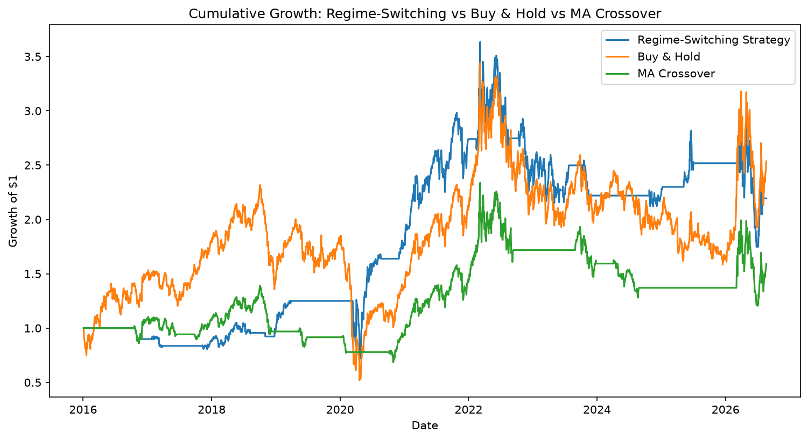

# Regime-Switching Model on Brent Crude

Following the Strait of Hormuz disruption in early 2026, Brent crude experienced erratic price movements, causing petrol prices to skyrocket everywhere. This motivated me to investigate whether different market behaviours could be modelled using Geometric Brownian Motion (GBM) and Ornstein–Uhlenbeck (OU) processes.

## Question
Can a regime-switching strategy outperform a simple moving-average crossover on Brent crude?

## Data
- Brent crude futures (`BZ=F`) daily closes from Yahoo Finance via `yfinance`
- Data range: ~2,700 trading days from January 2016 - August 2026.

## Method

- First, I set a 50/200-day moving-average crossover as the baseline to test against the regime-switching strategy. This was then backtested against buy-and-hold by calculating cumulative returns and Sharpe ratio. 
- Next, I calibrated GBM and OU parameters from log returns and linear regression respectively. For GBM, this led to an annualised drift of 8.8%, volatility 41.2%; for OU, it led to a long-run mean of $73.24, and θ = 1.28. 
- Now I built the regime classifier itself, using relative moving-average separation. The median threshold was a data-driven value of 7.4% that distinguished trending (GBM-like) from range-bound (OU-like) markets. 
- Finally I backtested the regime-switching strategy, holding Brent in GBM-classified regimes and moving to cash in OU-classified regimes, making sure to avoid look-ahead bias by having the positions lagged by one day.

## Results

| Strategy | Total return | Sharpe |
|---|---|---|
| MA crossover | 58.9% | 0.30 |
| Buy-and-hold | 153.6% | 0.42 |
| Regime-switching | 119.4% | 0.40 |

The regime-switching strategy was in the market for 46% of days (1,238 of 2,675).



## Key finding

The regime-switching strategy outperformed the baseline MA-crossover, nearly doubling MA's total return (119.4% vs 58.9%) and achieving a higher Sharpe ratio (0.40 vs 0.30). 

Although the regime-switching model underperforming in terms of returns in comparison to buy-and-hold (119.4% vs 153.6%), it recorded a comparable Sharpe ratio (0.40 vs 0.42) despite being invested for only 46% of the sample. 

## Limitations

The scope of this project was kept small, just focusing on the quantitative models themselves. As a result, the most important limitation was that there was no out-of-sample testing, so the result may not generalise beyond this period. Adding to that:

- Each day is classified independently, so short pullbacks and spikes cause misclassified days
- The median threshold was a simple choice as other percentiles weren't tested
- The OU fit was incredibly weak (R² = 0.0027), so daily mean reversion is mostly noise
- No transaction costs were modelled

## How to run

```
pip install -r requirements.txt
```

Then open `brent_regime_model.ipynb` and run all cells.